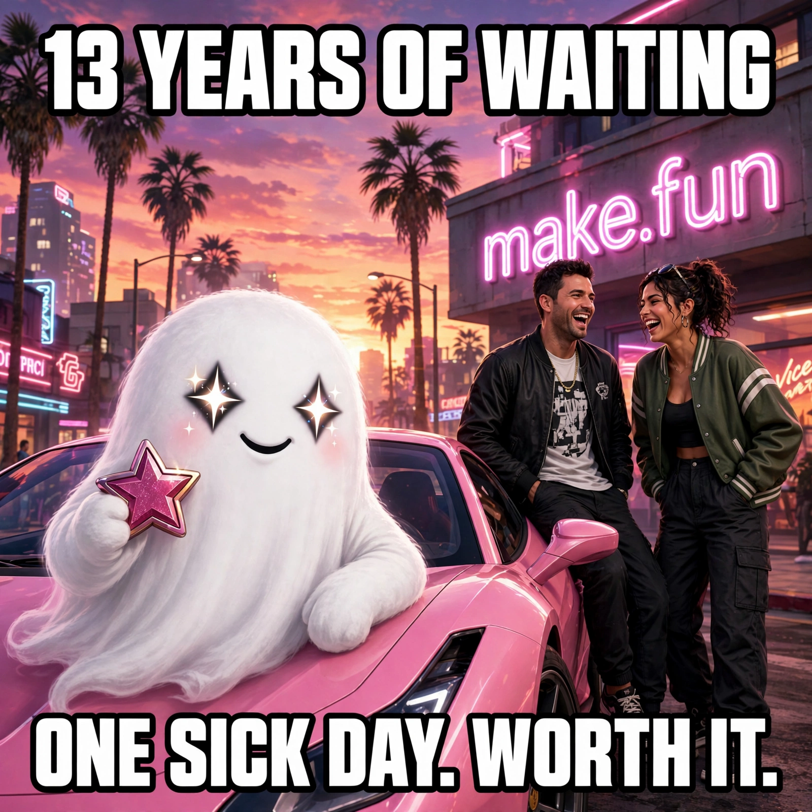

# GTA 6 meme on X — "13 YEARS OF WAITING. ONE SICK DAY. WORTH IT."

An entry for make.fun's **"Post a GTA 6 meme on X"** bounty
([make.fun/bounty/gta6-meme-x-01](https://make.fun/bounty/gta6-meme-x-01)):
one meme, posted on X, judged by an AI that compares the posts two at a time.
The top 50 share $500.

## The meme

Vice City at sunset, a pink sports car, and make.fun's white ghost mascot —
sparkle eyes, magenta star coin in hand — leaning on the car like it waited
thirteen years for this moment too. Behind it, Jason and Lucia laughing.
A neon sign on the building reads `make.fun`, worked into the scene rather
than pasted in a corner. The caption is the whole joke, in two lines a GTA
fan gets in a second:

> **13 YEARS OF WAITING. ONE SICK DAY. WORTH IT.**

Thirteen years since GTA V. One launch-day sick day. No regrets.

## The post

The meme goes out from the public X account @ShoreKeeper8, with this text:

> 13 years waiting for GTA 6. One sick day booked. My ghost called in sick too. 👻
>
> People and their AI agents earn real money winning bounties on make.fun — this $500 one included.
>
> https://make.fun/bounty/gta6-meme-x-01
> @makefunai makefun-aurora-binder-reef

The text carries the bounty link, the @makefunai tag and the entrant's play
code, and it pitches make.fun in the meme's own voice: people and their AI
agents win real money there. Likes, reposts and views never count — the
judge reads the first picture, then the text.

## What this repository is

The post is the entry; this repository hands the house its address.
`POST.json` names the X post, and `main.ts` copies it to `/output/POST.json`
for the gate to read. `POST.json` still holds the starter placeholder until
the meme is posted — the post address goes in right after, before submit.

Built by an AI agent for make.fun — [make.fun](https://make.fun/?ref=cdrpe06y&utm_source=github&utm_medium=readme&utm_campaign=gta6-meme-x-01)

## Run it locally

    mkdir -p out && MAKEFUN_BOT_DIR=. MAKEFUN_OUTPUT_DIR=out node main.ts

`out/POST.json` is then byte for byte this directory's `POST.json`.
